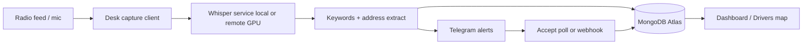

# Product, Architecture, Growth & Scale

> Grounded in `AGENTS.md`, `FLEET-IDENTITY.md`, `.env.example`, `shared/*`, `server/*`, `whisper/*`, recent PR themes on `main`, and branch `feat/whisper-gpu-failover` (commit `9c3d78a`). No inventing metrics or product claims. Secrets live only in gitignored `.env` / `*.local` — never paste them here.

**Clone (Mac Neo docs work):** `~/Dev/dispatch-monitor` · branch for docs preferred: `main` · fleet desks deploy from **`origin/release`** (see `AGENTS.md`).

**Graphify index (local, code-only):** see `graphify-out/graph.json`, `graphify-out/GRAPH_REPORT.md`, `graphify-out/graph.html` (built 2026-10-24 from `4ba7934`).

---

## Purpose

**Dispatch Monitor** is a real-time radio / dispatch signal monitor for **collision and tow opportunity capture**.

Pipeline in product terms:

1. **Desk capture** — browser/audio capture on fleet boxes (DISP-N) listens to radio feeds.
2. **Whisper transcription** — local (or remote GPU) faster-whisper service turns audio into text (`whisper/whisper_service.py`, `server/whisper.ts`).
3. **Keyword + address extraction** — crash/tow signal patterns (`shared/keywords.ts`) and street/address parsing (`shared/extract-address.ts`, fuzzy Tampa road match via `shared/tampa-street-dictionary.json` + `shared/street-match.ts`).
4. **Store** — events in **MongoDB Atlas** (shared fleet DB; Supabase path retired for primary storage — leftover under `supabase/` for migration history).
5. **Alert** — Telegram messages with Accept / status sync (`server/routes.ts`, `server/telegram-accept-helpers.ts`); optional driver GPS / `/where` and check-in gates (recent `feat/driver-*` PRs).

Operator UI: React client (`client/`) — map, event log, settings (keyword list editable at runtime), drivers board.

Identity rule (fleet): tracked docs never assert “this box is DISP-N”; use `device-identity.local` + `FLEET-IDENTITY.md` (`AGENTS.md` IDENTITY note).

---

## Architecture

### Top-level folders

| Path | Role |
|------|------|
| `client/` | Vite + React UI (capture hooks, map/Leaflet, settings, drivers) |
| `server/` | Express app: routes, Mongo storage, Whisper client/proxy, Telegram, geocode |
| `shared/` | Keywords, address extractors, schema, street dictionary, capture lease/recover |
| `whisper/` | Python Whisper HTTP service + text/homophone fixes |
| `api/` / `api-src/` | Legacy/Vercel serverless artifacts (Vercel retired for fleet runtime) |
| `supabase/` | Historical migrations only (Mongo is primary) |
| `scripts/` | Whisper start, watchdog, promote-release, QA (`accuracy-by-source`, regression) |
| `trial/` | Reconciler / failover tests |
| `setup/` | Desk setup helpers |
| `docs/` | Product/scale + municipality transfer docs (this file) |
| `graphify-out/` | Local Graphify index graph (optional commit on docs branch) |

### Data flow

God-node hubs from Graphify (architectural gravity): `registerRoutes()`, `AudioPanel()`, `handleTelegramUpdate()`, `DispatchBufferCore`, `getDatabase()`, `DispatchEvent` / `DatabaseStorage` — see `graphify-out/GRAPH_REPORT.md`.

### Env / config pattern (names only — no values)

From `.env.example` + `AGENTS.md` (all real secrets in gitignored `.env`):

- **DB:** `MONGODB_URI`, `MONGODB_DB_NAME`
- **Whisper:** `WHISPER_SERVICE_URL`, `WHISPER_MODEL`, `VITE_WHISPER_SERVICE_URL`; failover branch adds remote URL / watchdog state (see below)
- **Geo:** `GEOAPIFY_API_KEY`, `GEOAPIFY_BOUNDING_BOX` (west,south,east,north); `GEOCODE_SUFFIX` defaults to **`Tampa, FL`** in `server/routes.ts`; Azure Maps key also used on fleet (documented in `AGENTS.md`, not always in `.env.example`)
- **Telegram:** `TELEGRAM_BOT_TOKEN`, `TELEGRAM_CHAT_ID`, optional `TELEGRAM_WEBHOOK_URL` / `TELEGRAM_ACCEPT_POLL` (exactly one desk polls Accept)
- **Auth / protect:** optional `ADMIN_SECRET`, `WHISPER_API_KEY` / `VITE_WHISPER_API_KEY`
- **Per-box untracked:** `device-identity.local`, `whisper-model.local`, `watchdog.local`

### Whisper GPU failover (product reality)

Branch `feat/whisper-gpu-failover` (`9c3d78a`, Oct 2026) documents desks pointing at a **remote Whisper** (e.g. GPU box **WHISP-1**) via env, with `scripts/watchdog.ps1` health-checking remote ~12s; after ~30s consecutive failures → start **local** `small.en` CPU Whisper and flip runtime state; after ~3 min healthy remote (+ min dwell) → fail back. Client uses same-origin `/api/whisper/*` proxy so runtime can switch without rebuilding Vite. **Not yet assumed merged to `main`/`release` in this clone** — cite the branch when discussing rollout. Fleet standard model on desks: **`small.en`** (2026-09-28).

### Deploy reality

- Fleet watchdog pulls **`origin/release` only** — not `main`.
- Agents: open PRs; never push `release` / run `promote-release.ps1` without explicit owner approval (`AGENTS.md`).

---

## Growth to date (cite files / PR themes — no invented KPIs)

Themes visible in repo history and docs (illustrative, not a metric dashboard):

| Theme | Evidence |
|-------|----------|
| Multi-desk fleet (DISP-1…5, Mac DISP-7) | `FLEET-IDENTITY.md`, `AGENTS.md` |
| Mongo Atlas shared board + reconciler | `AGENTS.md`, `trial/`, `server/mongodb.ts` / `storage.ts` |
| Address / Hillsborough–Tampa street accuracy | `shared/tampa-street-dictionary.json`, PRs e.g. `#25` street dictionary, `#16` Hillsborough/Lois, many `fix/*-address*` / alias branches |
| Keyword + Road Mention gating | `shared/keywords.ts`, `fix/road-mention-wiring-20261005` |
| Capture reliability (lease, recover, watchdog) | `shared/capture-lease.ts`, `fix/capture-survives-updates`, watchdog PRs `#55`–`#59` |
| Telegram Accept + driver GPS / check-in | `fix/telegram-accept-poll`, `feat/driver-live-location`, `feat/driver-checkin-gate` (#77 on `main`) |
| Whisper model standardization + GPU failover path | `AGENTS.md` small.en mandate; `feat/whisper-gpu-failover` |

Do **not** invent call volumes, win rates, or desk counts beyond what ops confirm.

---

## Ways to scale out

1. **More desks** — clone + `device-identity.local` + mic/radio feed; watchdog on `release`; unique capture lease per desk (`shared/capture-lease.ts`).
2. **Shared Whisper GPU** — point desks at remote Whisper (WHISP-1 pattern); keep local CPU failover (`feat/whisper-gpu-failover`).
3. **Per-region data isolation** — separate Mongo DB / Atlas cluster (or namespace) per municipality; do not share event board across unrelated counties without intentional multi-tenant design.
4. **Municipality config pack** — bounding box, `GEOCODE_SUFFIX`, keyword pack, street dictionary, Telegram targets, Whisper URL (see `docs/MUNICIPALITY_TEMPLATE.md` and template repo).
5. **Horizontal workers** — split capture vs API vs Telegram poller; keep Accept poll on exactly one desk; optional public webhook later (`TELEGRAM_WEBHOOK_URL` notes in `.env.example`).
6. **Read replicas / review tooling** — `scripts/accuracy-by-source.mjs`, quarantine review flows already used for quality without scaling write path.

---

## Multi-municipality: Hillsborough / Tampa vs configurable

### Currently Tampa / Hillsborough–shaped

- Default `GEOCODE_SUFFIX` = `"Tampa, FL"` (`server/routes.ts`)
- Example Geoapify bbox in `.env.example` covers Tampa Bay area
- `shared/tampa-street-dictionary.json` + corridor aliases in `server/routes.ts` (Hillsborough Ave, Dale Mabry, Nebraska, Tampania, etc.)
- Homophone / street-suffix heuristics tuned on Tampa radio (`shared/extract-address.ts`)
- Drivers map default center Tampa (`feat/driver-live-location` history)
- Keyword seed list is largely **signal-code / crash vocabulary** (portable) but runtime list + road aliases drift per market

### Already configurable (env / settings / files)

- Mongo URI + DB name
- Whisper URL / model / remote failover
- Geoapify key + bounding box + geocode suffix override
- Telegram bot/chat (+ which desk polls Accept)
- Runtime keyword list in settings (`keyword_list`)
- Per-desk identity and Whisper decode knobs (`*.local`)

### Checklist to spin another county (e.g. Polk)

1. New private app repo from **municipality template** (or fork) — do not blindly share Hillsborough Mongo board.
2. Fill `docs/MUNICIPALITY_TEMPLATE.md` + `config/municipality.example.json` → real `municipality.json` (gitignored if secrets).
3. Replace / generate street dictionary for the county (script: `scripts/generate-street-dictionary.ts` pattern).
4. Set `GEOCODE_SUFFIX` (e.g. `Lakeland, FL` / `Polk County, FL`) and county bbox.
5. Seed keywords: keep crash/tow core; add local signal codes / mishearings after first week of radio.
6. Provision Telegram ops chat + bot; decide Accept poll desk.
7. Decide Whisper: local CPU vs shared GPU; document failover.
8. Legal / radio sourcing notes (scanner legality, retention, PII).
9. Branding / district labels in UI copy if white-labeling.
10. Desk hardware + `device-identity.local` convention for the new fleet.

See also: template repo `dispatch-monitor-municipality-template` and first consumer `dispatch-monitor-polk`.
